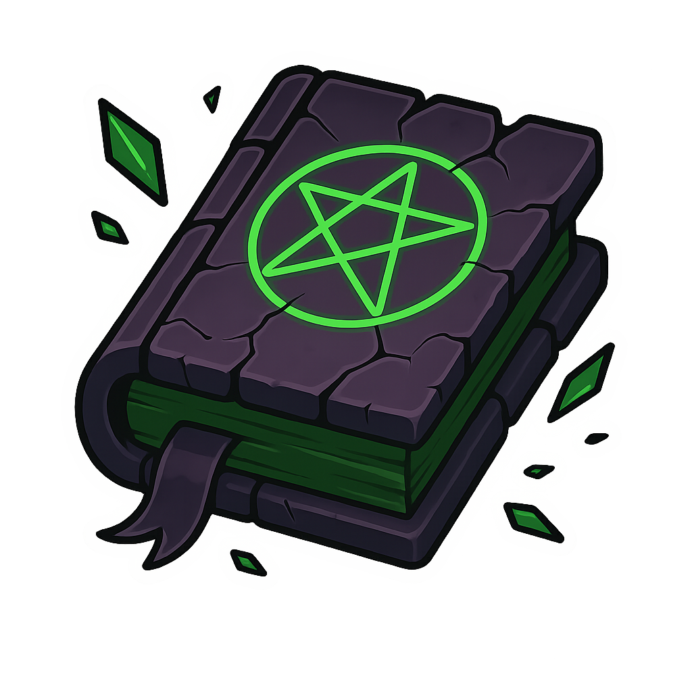
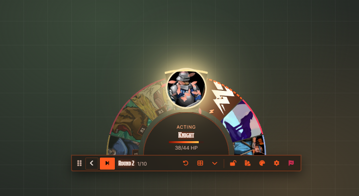
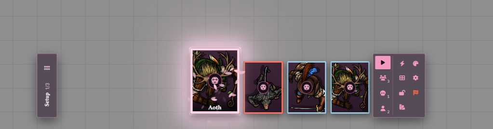
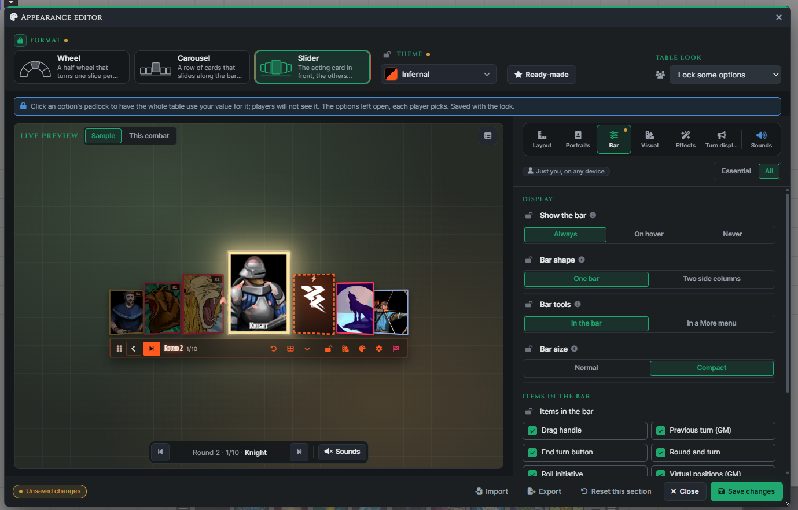
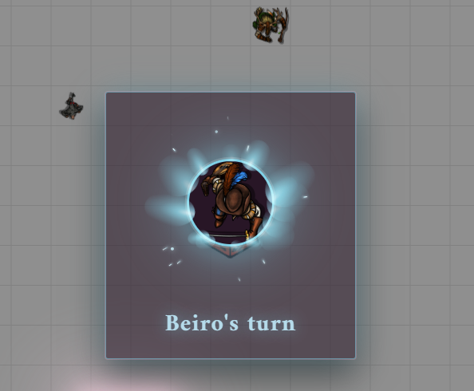
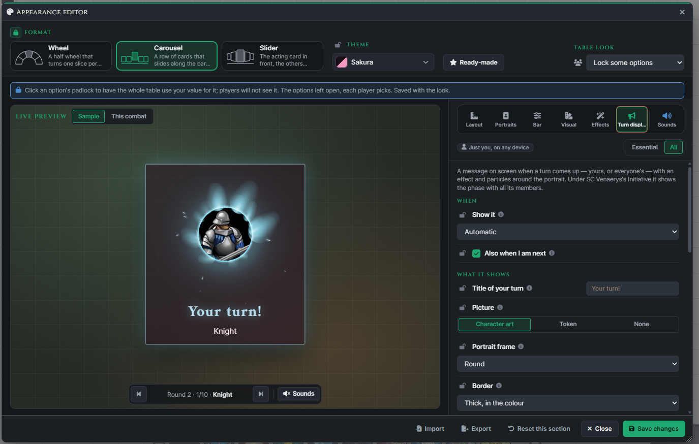
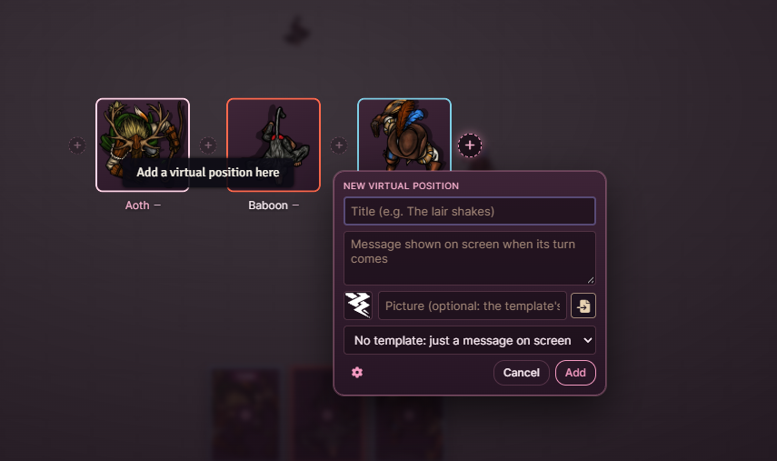
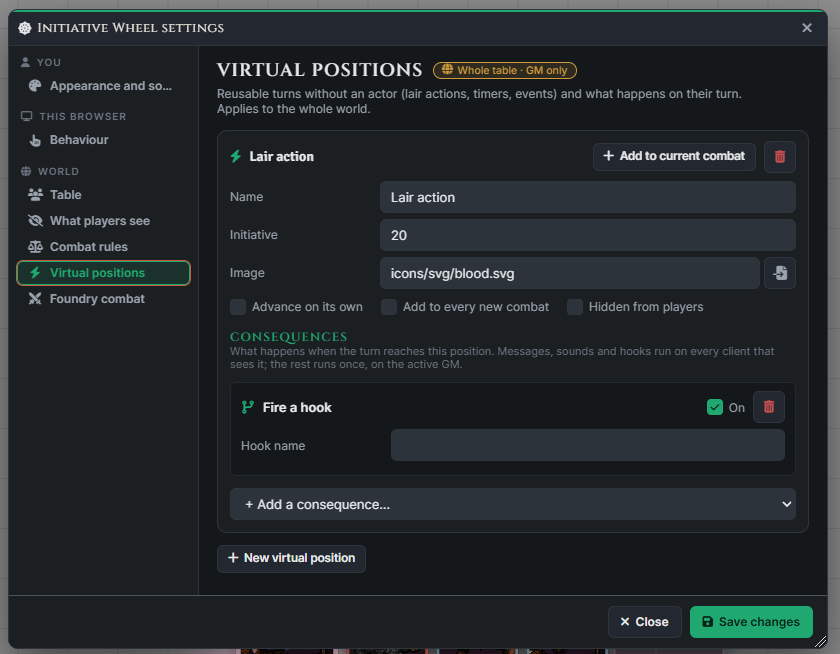
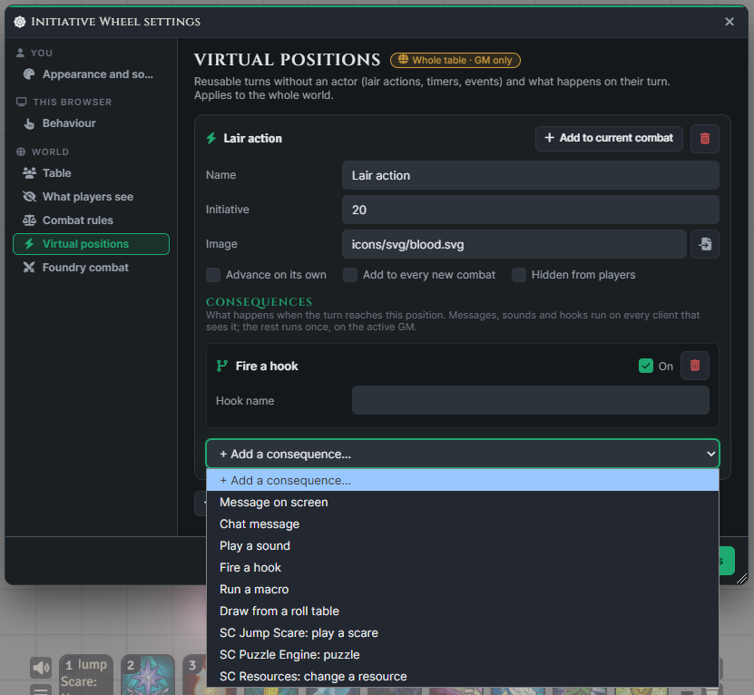

  

# SC - Combat Wheel

See who is acting, who comes next, and where the round turns over in **Foundry VTT**. **SC - Combat Wheel** presents the combat order as a movable initiative wheel, with portrait slices that rotate as turns advance and a control bar for running the encounter.

Choose the half-circle **Wheel**, a **Carousel**, or a **Slider**. Give each user their own look, share a table style, announce turns with portraits and effects, and add virtual positions for lair actions or encounter events.

The module follows Foundry's existing combat order. Picking a portrait to inspect it changes your view; advancing a turn uses Foundry's combat controls.

## Compatibility and Access

- **Foundry VTT v13 and v14**.
- **System agnostic**: the main display and controls use native Combat and Combatant documents. Health display can use system presets, token bars, or a configured actor attribute.
- **No required companion module**. Integrations listed below are optional.
- **English and Brazilian Portuguese** interface translations.

Combat Wheel is a premium Shattered Codex module. Eligible Patreon tiers are **The First Forgers** and **The Gem-Smith**. Visit [Shattered Codex on Patreon](https://www.patreon.com/c/shatteredcodex?utm_source=sc-combat-wheel&utm_medium=github&utm_campaign=support_readme) for membership information and use the [Download Hub](https://app.shattered-codex.com/) to obtain your installation manifest.

## Installation

1. Open the [Shattered Codex Download Hub](https://app.shattered-codex.com/) with an eligible active Patreon membership.
2. Find **SC - Combat Wheel** and copy its manifest URL.
3. In Foundry's setup screen, open **Add-on Modules > Install Module**.
4. Paste the manifest URL and install the module.
5. Launch your world and enable **SC - Combat Wheel** in **Manage Modules**.

See the [premium module installation guide](https://wiki.shattered-codex.com/guides/download-hub) for the Download Hub workflow and help with download authorization.

## Quick Start

1. Add tokens to a combat as usual. With **Open automatically** enabled, the wheel appears when the encounter has a participant you can see, before combat starts. Players focus on one of their own combatants for initiative.
2. Roll initiative. The GM can roll **Everyone**, **NPCs only**, or **Characters only**; players can roll their own pending initiatives.
3. Select **Start combat** as the GM. Use **End turn** and **Previous turn** to navigate the encounter. Players get **End my turn** while an owned combatant is acting.
4. Use **See everyone** to inspect the encounter, or open **Appearance** to choose a layout and theme.
5. Drag the control bar to position the widget, then lock it if desired. Position, lock state, and expanded details are saved for your user across devices.

The wheel opens again when combat starts if you closed it during setup, provided automatic opening is enabled. Deleting the combat closes its wheel and dismisses its turn announcement.

## Layouts and Portrait Controls

| View | What it shows |
| --- | --- |
| **Wheel** | A half-circle of portrait slices. The visible window stays a fixed size while additional participants move through the hidden half. |
| **Carousel** | A row of cards with a larger active portrait and smaller neighbouring portraits. |
| **Slider** | A card track with perspective and progressively smaller portraits away from the active turn. |

Adjust size, spacing, portrait shape, scale, and which side of the bar holds the portraits. The bar can show its tools directly or place them in **More**, with optional details and a split-column layout.

By default:

- **Click** a portrait to centre the camera on its visible token in the current scene.
- **Double-click** to open the actor's sheet when you have permission.
- **Right-click** for a menu with available camera, selection, and sheet actions. The GM can also remove the combatant or clear its recorded movement when available.
- **Hover** to highlight the corresponding visible token.

Click, double-click, and right-click actions can be changed in **Behaviour**. Camera following is optional and has an adjustable pan speed.

## See Everyone

**See everyone** opens an overview of the participants visible to you. Choose a portrait to bring it into focus on the wheel without changing whose turn it is; **Back to turn** returns to the active participant.

The GM can drag portraits to change initiative order, use a **+** between participants to insert a virtual position, and remove a virtual position with its **×** control. Players do not receive those editing controls. Hidden participants remain excluded from player overviews.

## Appearance, Saved Styles, and Sharing

Under **SC - Combat Wheel** in **Configure Settings > Module Settings**, choose **Edit appearance**. The editor previews your changes with a sample encounter or the current combat. Select **Save changes** to apply them.

Customisation includes:

- Wheel, Carousel, and Slider layouts, with portrait and control bar options.
- Themes, custom colours, palette generation, typography, corners, and panel styling.
- Portraits from token art or character art you have permission to see.
- Active-turn effects, turn-change effects, widget effects, and particles with adjustable intensity and motion.
- Turn announcement cards and the appearance of virtual-position messages.
- Per-event sounds, custom audio files, volume, and preview controls.

The GM can save named looks in **Styles** and apply them later through **Switch style…** in the token controls, combat tracker menu, or wheel. **Export** saves an appearance as a JSON file; **Import** loads one into the editor, where it can be previewed before saving. These files contain appearance values, excluding browser sound preferences and world combat rules.

Each user's saved appearance follows their account across devices. The GM's saved appearance also becomes the table look, with four sharing modes:

| Table look | Player experience |
| --- | --- |
| **Players choose** | Follow the GM's look or make a personal one. |
| **Lock some options** | Use the GM's values for individually locked options and customise the rest. |
| **Everyone uses mine** | Use the GM's appearance for the whole table. |
| **Everyone uses their own** | Each player uses their personal appearance. |

## Turn Announcements and Sounds

The **Turn display** tab configures on-screen announcements with a portrait, a customisable own-turn title, effects, and particles. Choose a card, cinematic band, or corner format; adjust its position, size, duration, entrance, and colour. The default announces every turn to the GM and a player's own turns to that player. Other modes announce only your own turns, everyone's turns, or none.

Players can enable **Show my card to the table** to share their announcement design on their character's turn. Recipients retain their own announcement timing, placement, size, duration, and title preferences, and can disable **See each player's card** to keep their own design for everyone.

The **Sounds** tab offers separate choices for combat start, turn changes, your turn, being up next, a new round, going back, and combat end. Sound preferences apply to the current browser; the GM can disable module sounds for the whole table. Turn sounds and announcements continue to work while the wheel is closed. Motion respects the operating system's reduced-motion preference.

## Health and Player Visibility

Select **Open settings** under **Configure Settings > Module Settings > SC - Combat Wheel** to configure **What players see** and **Combat rules**.

The GM chooses whether enemy health appears as exact values, a bar, descriptive states, or no health information. Owners and friendly combatants can show exact health. Health can also appear over the portraits as a visual overlay. If automatic detection does not match your system's data, choose token bar 1, token bar 2, or an actor attribute path; inverted values support systems that record damage taken.

Hidden combatants are excluded from player displays. Additional options follow hidden tokens or the invisible status, and NPC name visibility can follow token name-display settings. Defeated participants can remain visible with a defeated appearance or be removed from the wheel. The GM can separately enable automatic skipping for defeated or zero-health NPCs, or for all such combatants.

## Virtual Positions and Encounter Events

Use **Virtual positions** in the settings window to create reusable turns without an actor or token: a lair action, a ritual pulse, or a reminder that reinforcements arrive.

A template stores its name, image, fixed initiative, visibility, and consequences. It can join every new combat automatically and optionally advance to the next turn after its actions finish. Add a configured template through the wheel's menu or settings window, or insert a position using **+** in **See everyone**. The insertion form accepts a title, a message, an optional template, and an image, with a shortcut to manage templates.

Consequences include an on-screen message, sound, named hook, chat message, macro, or RollTable draw. They run when combat advances into the position; going back does not replay them. Macros and other GM-side actions execute on the active GM's client.

These optional integrations provide additional actions:

| Module | Integration |
| --- | --- |
| [SC - Jump Scare](https://wiki.shattered-codex.com/modules/sc-jump-scare) | Play a configured scare. |
| [SC - Puzzle Engine](https://wiki.shattered-codex.com/modules/sc-puzzle-engine) | Open, arm, or trigger a puzzle. |
| [SC - Resources](https://wiki.shattered-codex.com/modules/sc-resources) | Add, subtract, set, or restore configured actor resources. |

## SC - Venaerys's Initiative

With [SC - Venaerys's Initiative](https://wiki.shattered-codex.com/modules/sc-venaerys-initiative) active and the encounter using phases, the wheel displays phases in place of individual turns. A strip shows the current phase's members and their progress; players can mark their owned participants done, or done moving when movement and actions are split.

The GM navigates phases, and turn announcements can show the phase and its members together. Venaerys manages phase progression. Combat Wheel's initiative-reordering overview, virtual-position automation, and dead-turn skipping are not used in phased encounters.

## Settings and Keyboard Shortcuts

| Scope | Examples |
| --- | --- |
| **Your user, across devices** | Appearance, announcement preferences, widget position, lock state, and expanded details. |
| **This browser** | Automatic opening, portrait click actions, camera following, sounds, native tracker visibility, and which module buttons appear in the token controls. |
| **World · GM only** | Enemy visibility, health sources, combat rules, virtual-position templates, and Foundry combat settings. |

Assign shortcuts in Foundry's **Configure Controls**. No default keys are assigned. Available actions are **Show or hide the wheel**, **Next turn** and **Previous turn** (GM only), **Lock or unlock the wheel position**, **See everyone**, **Back to the current turn**, and **Reset wheel position**. Navigation actions use the open wheel.

## Troubleshooting

| Problem | What to check |
| --- | --- |
| The wheel does not appear | Check **Open automatically**, whether a combat exists, and whether you can see one of its participants. Use the token-controls button to reopen it. |
| The wheel was dragged out of reach | Use **Reset position** in **Behaviour**, the reset button in the token controls, or the GM's **Reset wheel position** tracker-menu action. |
| Appearance options are unavailable | Check whether you follow the GM's look or the GM has locked those options for the table. |
| Health is missing or incorrect | Check the health source, token bar or actor attribute, inversion setting, and the GM's player-health visibility choice. |
| Turn sounds overlap | Check both the wheel's sound choices and Foundry's combat sound theme, available in the appearance editor's **Sounds** tab. |
| An installation or update is not authorised | Open the Download Hub and sign in again to revalidate access, as described in the [installation guide](https://wiki.shattered-codex.com/guides/download-hub). |

## Support and Feedback

Created by **Gustavo Bacelar** as part of **Shattered Codex**.

- [Support development and explore membership on Patreon](https://www.patreon.com/c/shatteredcodex?utm_source=sc-combat-wheel&utm_medium=github&utm_campaign=support_readme).
- [Open the Download Hub](https://app.shattered-codex.com/) for module access and installation manifests.
- [Join the Discord community](https://discord.gg/6mWCQEJEwG) for questions, ideas, and feedback.
- Report bugs or request features on [GitHub](https://github.com/Shattered-Codex/sc-combat-wheel/issues) or [Discord](https://discord.gg/6mWCQEJEwG).
- [Browse the Shattered Codex wiki](https://wiki.shattered-codex.com/) for module documentation and guides.

When reporting a problem, include your Foundry version, game system and version, relevant companion modules, whether it affects the GM or players, and steps to reproduce it. Screenshots and console errors help explain what happened.
